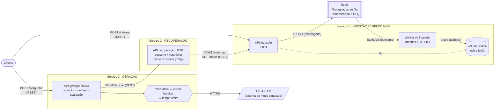
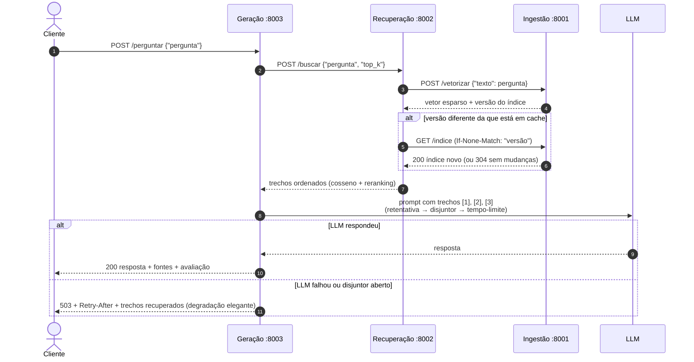

# RAG Distribuído em Microsserviços — C2.A2

**Sistemas Distribuídos e Computação em Nuvem · 2026/2**
Trabalho C2.A2, construído a partir do [kit de partida](https://github.com/howardroatti/sd-2026-2-kit-c2a2) da disciplina.

Sistema de perguntas e respostas com **geração aumentada por recuperação (RAG)** dividido
em **três microsserviços independentes**: ingestão, recuperação e geração. Uma pergunta
entra pela API de geração e sai uma resposta fundamentada nos documentos indexados, com
as fontes citadas. A chamada ao LLM (dependência externa lenta e instável) é protegida
por **circuit breaker, tempo-limite e retentativa**, e a ingestão passa por uma **fila
no Redis**.

> A IA aqui é caixa-preta: embeddings TF-IDF (scikit-learn, offline) e um cliente de LLM
> com **modo simulado** quando não há chave de API. O foco do trabalho é a engenharia
> distribuída.

---

## Sumário

1. [Arquitetura](#1-arquitetura)
2. [Como executar do zero](#2-como-executar-do-zero-docker)
3. [Testando a resiliência](#3-testando-a-resiliência)
4. [Referência da API](#4-referência-da-api)
5. [Decisões de projeto](#5-decisões-de-projeto)
6. [Execução local sem Docker e testes automatizados](#6-execução-local-sem-docker-e-testes-automatizados)
7. [Estrutura do repositório](#7-estrutura-do-repositório)

---

## 1. Arquitetura



<details>
<summary>Versão em texto do diagrama</summary>

```
                    POST /indexar                         POST /perguntar
   Cliente ───────────────────────────┐        ┌─────────────────────────── Cliente
                                      ▼        ▼
 ┌──────────── SERVIÇO 1: INGESTÃO ───────────┐   ┌──── SERVIÇO 3: GERAÇÃO ─────┐
 │  API :8001 ──LPUSH──► [Redis: fila] ──┐    │   │  API :8003                  │
 │     ▲  │                  BLMOVE      ▼    │   │   │ monta prompt [1],[2]... │
 │     │  │                       Worker      │   │   │ avalia a resposta       │
 │     │  └──lê──► (indice.joblib) ◄─grava─┘  │   │   ▼                         │
 └─────┼─────────────────────────────────────┘   │ retentativa                 │
       │ POST /vetorizar, GET /indice (REST)      │  └► circuit breaker         │
 ┌─────┴──── SERVIÇO 2: RECUPERAÇÃO ─────────┐   │      └► tempo-limite ───────┼──► API do LLM
 │  API :8002  cosseno + reranking + cache   │◄──┼── POST /buscar (REST)       │   (ou simulado)
 └───────────────────────────────────────────┘   └─────────────────────────────┘
```
</details>

### Os três serviços

| Serviço | Processos / contêineres | Responsabilidade | Fala com |
|---|---|---|---|
| **1. Ingestão / embeddings** | `ingestao` (API, porta 8001) e `ingestao-worker` | Recebe documentos, divide em trechos, gera os embeddings TF-IDF e persiste o índice em disco. É o **dono** do índice e do vetorizador. | Redis (fila) |
| **2. Recuperação** | `recuperacao` (porta 8002) | Dada uma pergunta, devolve os `top_k` trechos mais relevantes (cosseno + reranking). Mantém uma cópia em cache do índice. | Ingestão (REST) |
| **3. Geração** | `geracao` (porta 8003) | Monta o prompt com os trechos numerados, chama o LLM com proteção de resiliência, cita as fontes e avalia a resposta. | Recuperação (REST) e LLM (HTTPS) |

Cada serviço tem o próprio `Dockerfile`, roda no próprio processo e só se comunica com os
outros pela rede. Nenhum serviço lê o disco ou o banco de outro: a recuperação obtém o
índice e a vetorização da pergunta **pela API** da ingestão.

### Fluxo de uma pergunta (ponta a ponta)



### Onde está a mensageria

A **ingestão é assíncrona**: `POST /indexar` apenas valida e publica os documentos na fila
`rag:ingestao:fila` do Redis, devolvendo **202 Accepted** com um `tarefa_id`. O
`ingestao-worker` consome a fila e faz o trabalho pesado (com TF-IDF, cada ingestão
reajusta o vocabulário e revetoriza todos os trechos). O cliente acompanha em
`GET /tarefas/{id}` (`na_fila` → `processando` → `concluida` | `falhou`).

A fila é **confiável**:

- `BLMOVE` atômico da fila para a lista `rag:ingestao:processando`: se o worker morrer no
  meio, a mensagem não se perde e volta para a fila quando ele reiniciar;
- confirmação (`LREM`) só depois de o índice ser gravado;
- falhas voltam para a fila até `INGESTAO_MAX_TENTATIVAS` (3) e depois vão para a fila de
  mensagens mortas `rag:ingestao:dlq`;
- reenviar um documento com a mesma `origem` o **substitui** (processamento idempotente);
- o Redis roda com AOF, então a fila sobrevive a um reinício do broker.

### Resiliência

**Na chamada ao LLM (serviço de geração)**, três camadas, de fora para dentro:

```
retentativa ( circuit breaker ( tempo-limite ( LLM ) ) )
```

| Mecanismo | Configuração (padrão) | Comportamento |
|---|---|---|
| **Tempo-limite** | `LLM_TIMEOUT=8` s | Cada tentativa tem prazo garantido por uma thread com `future.result(timeout)`, inclusive no modo simulado. Estourou → `TempoEsgotado`, que conta como falha. |
| **Circuit breaker** | `DISJUNTOR_LIMITE_FALHAS=3`, `DISJUNTOR_ESPERA_SEGUNDOS=20` | **Fechado**: chamadas passam. Com 3 falhas consecutivas → **aberto**: recusa imediata, sem tocar na API. Após 20 s → **meio-aberto**: passa **uma** chamada de teste (as concorrentes são recusadas); sucesso fecha, falha reabre. É thread-safe. |
| **Retentativa** | `LLM_TENTATIVAS=3` | Backoff exponencial (0,5 s, 1 s…) com jitter. **Não** repete quando o circuito está aberto nem em erro permanente (4xx, exceto 429). |
| **Degradação elegante** | — | Se o LLM falhar, a resposta é **503** com `Retry-After`, motivo, estado do disjuntor e os **trechos recuperados com as fontes**. Nunca um 500. |

**Nos demais pontos:**

| Falha | O que acontece |
|---|---|
| Recuperação fora do ar | Geração tenta 2 vezes (timeout de conexão 2 s) e responde **503** com mensagem clara. |
| Ingestão fora do ar | Recuperação tenta 3 vezes; se já tiver o índice em cache, **degrada para busca léxica** (`"modo": "lexico (degradado...)"`) em vez de falhar. Sem cache → 503, e a geração repassa o motivo ao cliente. |
| Redis fora do ar | `POST /indexar` responde 503; consultas continuam funcionando (o índice está em disco); o worker reconecta sozinho com backoff exponencial. |
| Worker cai no meio de uma tarefa | A mensagem fica em `processando` e é devolvida à fila quando o worker volta. |
| Contêiner reinicia | O índice persiste no volume `indice` (gravação atômica: arquivo temporário + `os.replace`). |
| Pergunta sem trecho relevante | Não chama o LLM e responde que não encontrou a informação (não inventa resposta). |

### Extensões opcionais implementadas

- **Reranking**: a recuperação pré-seleciona os candidatos por cosseno e os reordena por
  `0,7 × cosseno + 0,3 × cobertura dos termos da pergunta` (peso em `RERANK_PESO_SIMILARIDADE`).
- **Citação das fontes**: trechos numerados `[n]` no prompt e lista `fontes` na resposta
  (documento de origem, id do trecho e pontuação).
- **Persistência dos vetores em disco**: `indice.joblib` em volume Docker.
- **Avaliação automática**: `fundamentacao` (fração dos termos da resposta presentes nos
  trechos), `cobertura_pergunta`, `cita_fontes` e um `veredito`.

---

## 2. Como executar do zero (Docker)

**Pré-requisitos:** Git, Docker com Docker Compose v2 e Python 3 (só para os scripts
auxiliares, que usam apenas a biblioteca padrão — não precisa de venv). Internet só é
necessária para baixar as imagens; o sistema roda offline.

```bash
# 1. Clonar
git clone https://github.com/nascimentodavi/rag-distribuido-microservicos-c2a2.git
cd rag-distribuido-microservicos-c2a2

# 2. Configuração (sem chave de API = LLM em modo simulado, offline)
cp .env.example .env

# 3. Subir os 5 contêineres (redis, ingestao, ingestao-worker, recuperacao, geracao)
docker compose up --build -d
docker compose ps          # aguarde todos ficarem "healthy"

# 4. Indexar a base de documentos (passa pela fila do Redis)
python3 scripts/carregar_documentos.py
#   8 documento(s) enfileirado(s) -> tarefa 95dc12b5...
#     estado: processando
#     estado: concluida
#   indice na versao 1 com 20 trechos

# 5. Perguntar
python3 scripts/perguntar.py "O que diz o teorema CAP?"
python3 scripts/perguntar.py "Por que usar fila de mensagens entre serviços?"
```

O mesmo com `curl`:

```bash
curl -X POST http://localhost:8001/indexar -H "Content-Type: application/json" \
  -d '[{"texto":"O teorema CAP trata de consistencia e disponibilidade.","origem":"aula10"}]'
# {"tarefa_id":"...","estado":"na_fila",...}

curl -X POST http://localhost:8003/perguntar -H "Content-Type: application/json" \
  -d '{"pergunta":"o que diz o teorema CAP?"}'
```

Resposta (resumida):

```json
{
  "pergunta": "o que diz o teorema CAP?",
  "resposta": "[MODO SIMULADO - sem LLM_API_KEY configurada] ... [1] (fonte: teorema_cap) O teorema CAP afirma que ...",
  "fontes": [{"n": 1, "origem": "teorema_cap", "trecho": "teorema_cap#0", "pontuacao": 0.56}],
  "avaliacao": {"fundamentacao": 0.75, "cobertura_pergunta": 1.0, "cita_fontes": true, "veredito": "fundamentada"},
  "metadados": {"modo_busca": "vetorial", "versao_indice": 1, "modo_llm": "simulado",
                "tentativas_llm": 1, "disjuntor": "fechado", "tempo_ms": 15}
}
```

**Usando um LLM de verdade:** preencha `LLM_API_KEY` no `.env` (qualquer API compatível com
o formato *chat completions* da OpenAI; ajuste `LLM_API_URL` e `LLM_MODELO`) e rode
`docker compose up -d geracao`. A chave **nunca** vai para o código: o `.env` está no
`.gitignore`.

**Logs e encerramento:**

```bash
docker compose logs -f ingestao-worker geracao
docker compose down          # para tudo (mantém o índice e a fila nos volumes)
docker compose down -v       # para tudo e apaga os volumes
```

---

## 3. Testando a resiliência

### Demonstração automática do circuit breaker

```bash
python3 scripts/demo_resiliencia.py
```

```
1) LLM saudavel
   HTTP 200 em      7 ms | chamadas ao LLM: 1 | disjuntor: FECHADO (falhas consecutivas 0/3)

2) Simulando a API do LLM fora do ar (POST /admin/falhas modo=erro)
   HTTP 503 em   1541 ms | chamadas ao LLM: 3 | disjuntor: ABERTO (falhas consecutivas 3/3)
   motivo: falha ao chamar o LLM: FalhaSimulada: falha simulada: API do LLM fora do ar

3) Nova pergunta com o circuito aberto: recusa imediata
   HTTP 503 em     24 ms | chamadas ao LLM: 0 | disjuntor: ABERTO (falhas consecutivas 3/3)
   motivo: circuito aberto: o LLM falhou repetidamente e esta em quarentena

4) LLM volta ao normal; aguardando 20s ate o disjuntor liberar o teste...
   HTTP 200 em     26 ms | chamadas ao LLM: 1 | disjuntor: FECHADO (falhas consecutivas 0/3)
```

Repare no passo 3: com o circuito aberto, a resposta sai em ~20 ms sem nenhuma chamada ao
LLM, contra ~1,5 s do passo 2 (três tentativas com backoff).

### Simulador de falhas do LLM

O serviço de geração tem um injetor de falhas (só para demonstração), controlado por
`LLM_SIMULAR_FALHA` no `.env` ou em tempo de execução:

```bash
curl -X POST localhost:8003/admin/falhas -H "Content-Type: application/json" -d '{"modo":"erro"}'
#   modos: normal | erro (API fora do ar) | lentidao (estoura o tempo-limite) | intermitente (50% de falha)
curl localhost:8003/saude     # estado do disjuntor, falhas, recusas, última falha
```

- `lentidao`: cada tentativa é cortada pelo tempo-limite (`LLM_TIMEOUT`); o disjuntor abre.
- `intermitente`: a maioria das perguntas ainda responde 200, porque a retentativa
  absorve as falhas isoladas (veja `metadados.tentativas_llm`).

### Falhas reais

```bash
# LLM real sem rede: com LLM_API_KEY preenchida, desligue a internet (ou aponte
# LLM_API_URL para um host inexistente) -> ConnectionError -> retentativa -> disjuntor abre
# -> 503 com os trechos recuperados.

# Derrubar a recuperação: a geração responde 503 "servico de recuperacao indisponivel"
docker compose stop recuperacao
python3 scripts/perguntar.py "teorema CAP"
docker compose start recuperacao

# Derrubar a ingestão: a recuperação degrada para busca léxica com o índice em cache
# (o cache é preenchido na primeira pergunta; se a recuperação acabou de reiniciar,
#  faça uma pergunta antes, senão a resposta é 503 "ingestao indisponivel e sem indice em cache")
python3 scripts/perguntar.py "teorema CAP" > /dev/null
docker compose stop ingestao
python3 scripts/perguntar.py "teorema CAP" --json | grep modo_busca
docker compose start ingestao

# Derrubar o worker: a ingestão continua aceitando (202) e a tarefa espera na fila
docker compose stop ingestao-worker
python3 scripts/carregar_documentos.py --espera 5      # fica em "na_fila"
docker compose start ingestao-worker                   # o worker consome o que ficou
curl localhost:8001/saude                               # filas: na_fila / processando / mortas

# Persistência: reinicie tudo e pergunte de novo, sem reindexar
docker compose restart && python3 scripts/perguntar.py "o que e Raft?"
```

---

## 4. Referência da API

Cada serviço também publica documentação interativa em `/docs` (Swagger do FastAPI),
por exemplo <http://localhost:8003/docs>.

**Ingestão — `:8001`**

| Método e rota | Descrição |
|---|---|
| `POST /indexar` | Corpo: `[{"texto": "...", "origem": "nome"}]`. Enfileira e responde **202** com `tarefa_id`. A mesma `origem` substitui o documento. |
| `GET /tarefas/{id}` | Estado da tarefa: `na_fila`, `processando`, `concluida` (com `versao_indice`) ou `falhou`. |
| `POST /vetorizar` | `{"texto"}` → vetor esparso (`indices`, `valores`) + `versao`. **409** se o índice estiver vazio. |
| `GET /indice` | Todos os trechos com vetores esparsos. Envia `ETag`; com `If-None-Match` igual responde **304**. |
| `GET /documentos` | Documentos indexados. |
| `GET /saude` | Redis, tamanho das filas (incluindo DLQ) e versão do índice. |

**Recuperação — `:8002`**

| Método e rota | Descrição |
|---|---|
| `POST /buscar` | `{"pergunta", "top_k": 3, "reranking": true, "min_similaridade": 0.05}` → `resultados` com `origem`, `texto`, `similaridade`, `cobertura` e `pontuacao`; `modo` vetorial ou léxico (degradado). |
| `GET /saude` | Estado da ingestão e versão do índice em cache. |

**Geração — `:8003`**

| Método e rota | Descrição |
|---|---|
| `POST /perguntar` | `{"pergunta", "top_k": 3}` → **200** com `resposta`, `fontes`, `contexto`, `avaliacao`, `metadados`; ou **503** degradado (LLM ou recuperação indisponível). |
| `POST /admin/falhas` | `{"modo": "normal" \| "erro" \| "lentidao" \| "intermitente"}` (demonstração). |
| `GET /saude` | Modo do LLM, tempo-limite e métricas do disjuntor. |

---

## 5. Decisões de projeto

- **Por que a fila está na ingestão?** É a etapa naturalmente assíncrona e a mais cara
  (reajustar o TF-IDF e revetorizar todo o corpus). Com a fila, o cliente recebe 202 na
  hora, picos de documentos se acumulam no broker em vez de derrubar a API, e a ingestão
  continua aceitando documentos mesmo com o worker parado. A pergunta, ao contrário,
  é interativa (o usuário espera a resposta), então segue por REST síncrono protegido por
  timeouts.
- **Por que a recuperação pede a vetorização à ingestão?** Com TF-IDF, a pergunta precisa
  ser vetorizada com o **mesmo vocabulário** usado no índice. Em vez de compartilhar o
  arquivo do modelo entre serviços (acoplamento por disco), a ingestão, dona do
  vetorizador, expõe `POST /vetorizar`. A resposta traz a versão do índice, o que permite
  à recuperação detectar quando o cache ficou velho.
- **Cache com ETag e vetores esparsos:** a recuperação não baixa o índice a cada pergunta;
  só quando a versão muda (`If-None-Match` → 304). Os vetores TF-IDF têm milhares de
  dimensões quase todas zero, então trafegam no formato esparso (`indices`, `valores`).
- **Ordem das camadas de resiliência:** o disjuntor fica **dentro** da retentativa para
  que cada tentativa conte como uma falha e para que a retentativa pare assim que o
  circuito abrir. O tempo-limite fica **dentro** do disjuntor para que lentidão também
  seja contada como falha.
- **503 com conteúdo em vez de 500:** quando o LLM falha, o usuário ainda recebe os trechos
  relevantes e as fontes, além de `Retry-After` indicando quando tentar de novo. É a
  degradação elegante pedida no roteiro.
- **API e worker no mesmo serviço:** ambos pertencem ao serviço de ingestão (mesma imagem,
  mesmo volume). A API só **lê** o índice e o worker só **escreve**, com gravação atômica,
  então a API nunca enxerga um arquivo pela metade.

### Limitações conhecidas

- O estado do disjuntor é **por processo** (cada réplica da geração teria o seu); para
  várias réplicas, o estado poderia ir para o Redis.
- A fila confiável assume **um único worker** (a recuperação de mensagens órfãs move tudo de
  `processando` de volta para a fila). Com vários workers, cada um precisaria da própria
  lista de processamento.
- Com TF-IDF, toda ingestão revetoriza o corpus inteiro: adequado para a escala do trabalho,
  mas um modelo de embeddings fixo (ex.: sentence-transformers) permitiria indexação
  incremental.

---

## 6. Execução local sem Docker e testes automatizados

```bash
python3 -m venv .venv
source .venv/bin/activate            # Windows: .venv\Scripts\activate
pip install -r requirements.txt -r requirements-dev.txt

docker run -d --name redis-rag -p 6379:6379 redis:7-alpine   # ou um Redis local

# um terminal para cada processo (os padrões já apontam para localhost)
python -m servicos.ingestao.worker
uvicorn servicos.ingestao.app:app     --port 8001
uvicorn servicos.recuperacao.app:app  --port 8002
uvicorn servicos.geracao.app:app      --port 8003
```

Para usar as variáveis do `.env` fora do Docker: `set -a; source .env; set +a` antes de
iniciar cada processo.

**Testes automatizados** (não precisam de Redis nem de rede; usam `fakeredis` e os três
serviços ligados em memória):

```bash
python -m pytest -q testes
```

Cobrem os estados do disjuntor (inclusive o teste único no meio-aberto), backoff e
tempo-limite, fila confiável (DLQ e recuperação após queda do worker), persistência do
índice, ETag, busca e reranking, degradação léxica e o fluxo completo de ponta a ponta com
falhas do LLM (fora do ar, lento, intermitente, chave inválida e host inacessível).

---

## 7. Estrutura do repositório

```
.
├── servicos/
│   ├── comum/                    # código compartilhado (biblioteca, não é serviço)
│   │   ├── embeddings.py         # vetorizador TF-IDF do kit (+ saída esparsa)
│   │   ├── llm.py                # cliente de LLM do kit (modo simulado offline)
│   │   ├── circuit_breaker.py    # disjuntor thread-safe com métricas
│   │   ├── resiliencia.py        # tempo-limite e retentativa com backoff
│   │   └── texto.py              # normalização e divisão em trechos
│   ├── ingestao/                 # SERVIÇO 1
│   │   ├── app.py                # API REST (publica na fila)
│   │   ├── worker.py             # consumidor da fila
│   │   ├── fila.py               # fila confiável sobre Redis
│   │   ├── armazenamento.py      # índice persistido em disco
│   │   └── Dockerfile
│   ├── recuperacao/              # SERVIÇO 2
│   │   ├── app.py                # busca, reranking, cache do índice
│   │   └── Dockerfile
│   └── geracao/                  # SERVIÇO 3
│       ├── app.py                # prompt, LLM protegido, fontes
│       ├── avaliacao.py          # avaliação automática da resposta
│       ├── injetor_falhas.py     # simulação de falhas do LLM (demo)
│       └── Dockerfile
├── documentos/                   # base de conhecimento (.txt)
├── scripts/                      # carga, consulta e demo do disjuntor
├── testes/                       # pytest
├── docker-compose.yml
├── .env.example
├── requirements.txt / requirements-dev.txt
└── TAREFAS.md
```
